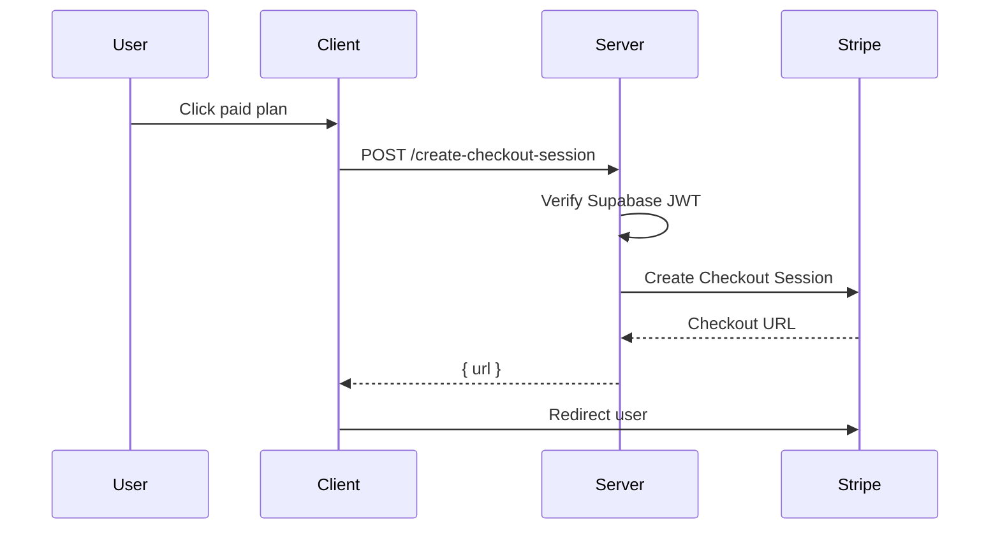
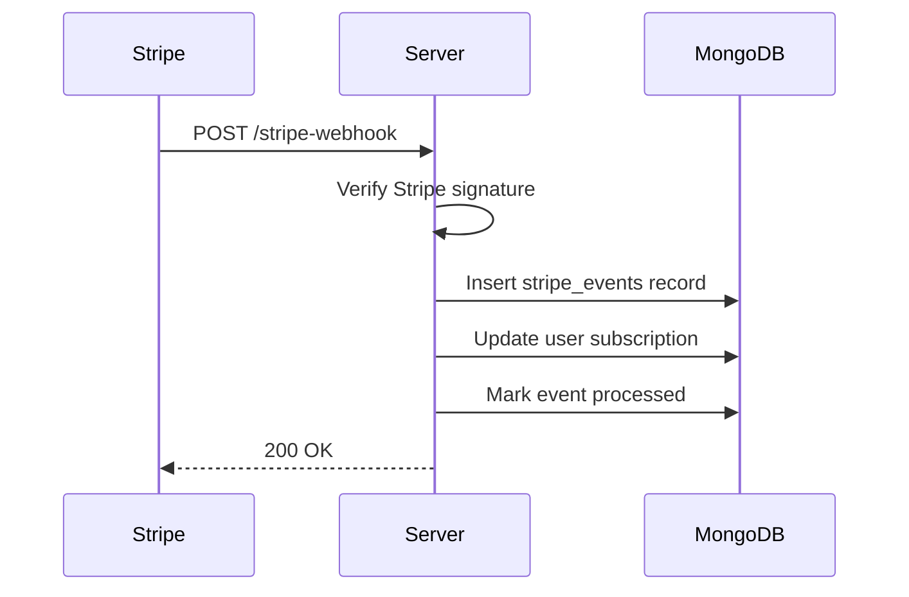

# Payments

Payments are handled by Stripe Checkout and Stripe webhooks.

## Plan config

Plans are defined in `server/config.py`.

Each paid plan has:

- `tier`: `plus` or `pro`
- `interval`: `month` or `year`
- `price_id`: Stripe recurring Price ID
- `checkout`: `true`

The free plan has no Stripe price and no checkout.

`GET /plans` returns public plan data and intentionally removes `price_id`.

## Checkout flow



The checkout session includes metadata:

```py
{
  "user_id": "supabase-user-id",
  "tier": "plus|pro",
  "interval": "month|year"
}
```

That metadata is later used by webhooks to update the user's subscription state.

## Webhook flow



## Stored Stripe events

Every verified Stripe event is stored in `stripe_events` using the Stripe event id as `_id`.

Example:

```py
{
  "_id": "evt_...",
  "type": "checkout.session.completed",
  "created": 1234567890,
  "livemode": False,
  "payload": {...},
  "processed": True,
  "received_at": datetime,
  "processed_at": datetime,
  "error": None
}
```

This gives us:

- idempotency
- audit history
- easier debugging
- replay/recovery options later

Duplicate webhook events return:

```json
{ "ok": true, "duplicate": true }
```

## Subscription updates

Handled events:

- `checkout.session.completed`
  - sets user's paid tier, interval, Stripe customer id, subscription id
- `customer.subscription.deleted`
  - resets user to free
- `customer.subscription.paused`
  - resets user to free

## Important config

Root `.env` needs:

```bash
STRIPE_SECRET_KEY=...
STRIPE_WEBHOOK_SECRET=...
FRONTEND_URL=...
```

Stripe price ids must be set in `server/config.py` before production.
